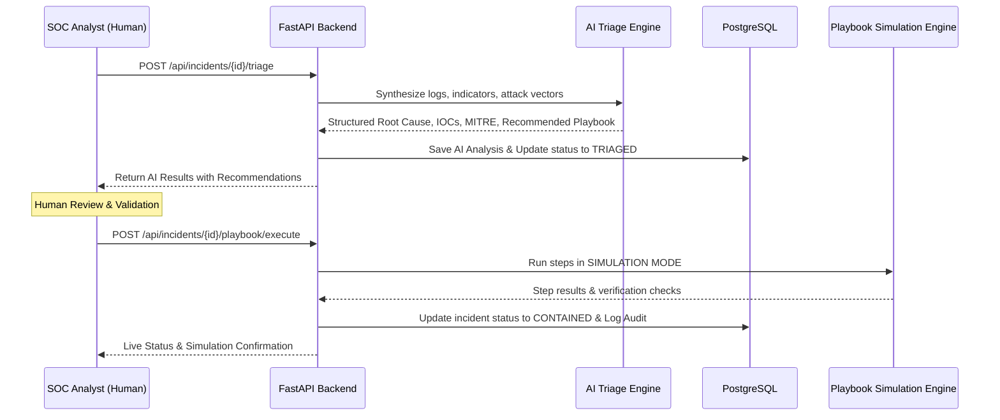

# Responsible AI & Simulation Workflow — AIAC Cyber

## 1. AI Assistant Philosophy

AIAC Cyber implements an **AI-Assisted** model with strict **Human-in-the-Loop (HITL)** oversight. 

---

## 2. Safety & Responsible AI Guardrails

1. **No Autonomous Destructive Execution**: The AI does not execute arbitrary operating system commands autonomously.
2. **Simulation Mode Transparency**: All defensive containment actions are executed in simulated sandbox modes with clear UI labels (`SIMULATION MODE`).
3. **Structured Classification**: Outputs adhere to structured security schemas with confidence intervals and root cause rationale rather than unconstrained text.
4. **MITRE ATT&CK Mapping**: Every triage maps threats directly to standardized adversary tactics and techniques.
