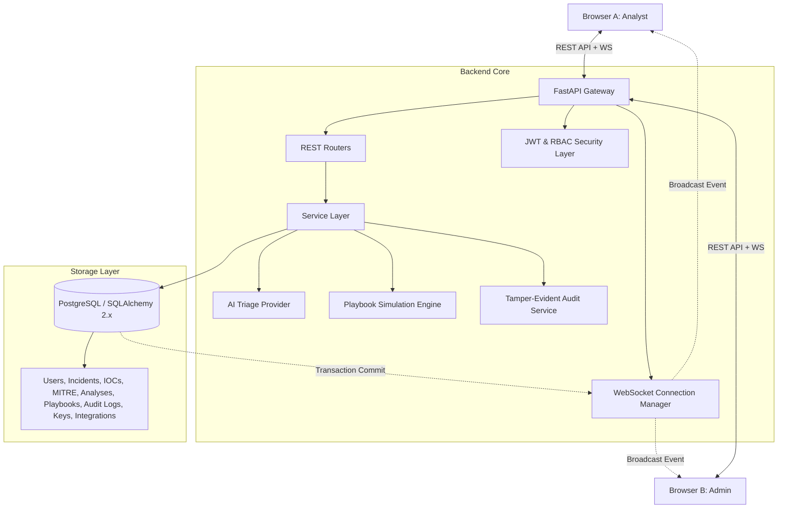

# Architecture Specification — AIAC Cyber

## 1. High-Level Architecture Overview

AIAC Cyber follows a clean layered client-server architecture with decoupled presentation, backend services, real-time message broadcasting, and persistent database storage.

---

## 2. Core Components

### 2.1 Frontend Presentation Tier
- **Technology**: Vanilla HTML5, CSS3 (Liquid Glass Cyber Design System), JavaScript (ES6+ Modules).
- **API Client (`js/api.js`)**: Encapsulates all REST calls to the FastAPI backend, automatically attaching Bearer JWT tokens and handling refresh token expiration.
- **WebSocket Manager (`js/websocket.js`)**: Single centralized persistent connection to `/api/ws` with exponential backoff auto-reconnect and real-time DOM event dispatching.
- **Chart.js**: Dynamic telemetry graphs for daily threat volume, resolution MTTR curves, and infrastructure risk heatmaps.

### 2.2 Backend Application Tier (FastAPI)
- **Framework**: Python 3.10+ FastAPI with asynchronous event handling and strict Pydantic V2 schema validation.
- **Routers**:
  - `auth.py`: Authentication, JWT issuance, session profiles.
  - `incidents.py`: Incident lifecycle management, search, filtering, and pagination.
  - `ai.py`: AI triage orchestration and prompt-to-structure synthesis.
  - `playbooks.py`: Responsible simulation engine for defensive containment.
  - `analytics.py`: Real-time aggregated metrics from database tables.
  - `audit.py`: Immutable audit logging.
  - `users.py`: Operator RBAC management.
  - `api_keys.py`: Scoped API credential provisioning with hashed storage.
  - `integrations.py`: Ecosystem connector management and health verification.
  - `health.py`: Liveness (`/health`) and readiness (`/health/ready`) probes.
  - `websocket.py`: Authenticated real-time event pipeline.

### 2.3 Storage & Persistence Tier
- **Database**: PostgreSQL 15 (with SQLite fallback for local developer prototyping).
- **ORM**: SQLAlchemy 2.0 with Declarative Base mapping.
- **Schema Migrations**: Alembic auto-generating and executing versioned database schema upgrades.

---

## 3. Data Flow Patterns

### 3.1 Incident Ingest & Real-Time Propagation
1. Client submits `POST /api/incidents`.
2. Backend validates request against Pydantic schema `IncidentCreate`.
3. Database inserts record into `incidents` table and sets initial status `DETECTED`.
4. Database commits transaction (`db.commit()`).
5. Backend invokes `manager.broadcast("incident.created", data)`.
6. All connected clients receive the event and prepend the new incident to their live view without refreshing.

### 3.2 AI Triage & Playbook Execution
1. Analyst clicks "Run AI Triage" (`POST /api/incidents/{id}/triage`).
2. Backend emits `ai.analysis.started` event to indicate analysis in progress.
3. AI Provider analyzes logs, determines threat classification, extracts IOCs, maps MITRE tactics, and proposes containment actions.
4. Telemetry is saved in `ai_analyses`, `iocs`, and `mitre_techniques` tables; status transitions to `TRIAGED`.
5. Backend emits `ai.analysis.completed`.
6. Analyst reviews recommendations and triggers `POST /api/incidents/{id}/playbook/execute`.
7. Playbook simulation runner executes steps safely in `SIMULATION MODE`, updates incident status to `CONTAINED`, logs audit trail, and emits `playbook.completed`.
