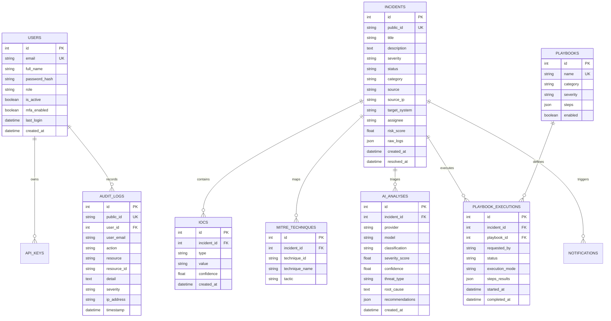

# Database Specification — AIAC Cyber

## 1. Relational Schema Architecture (PostgreSQL)

AIAC Cyber uses SQLAlchemy 2.0 ORM models with strictly defined foreign key constraints, indexes, and cascading deletion policies.



---

## 2. Alembic Migrations

Schema migrations are managed via Alembic:
- Configuration: `backend/alembic.ini`
- Environment: `backend/alembic/env.py`
- Version scripts: `backend/alembic/versions/`

### Applying Migrations
```bash
cd backend
alembic upgrade head
```

---

## 3. Database Seeder
The seed service (`backend/app/db/seed.py`) executes during startup when `DEMO_MODE=True`, populating realistic SOC telemetry, users, playbooks, integrations, API keys, and audit logs.
